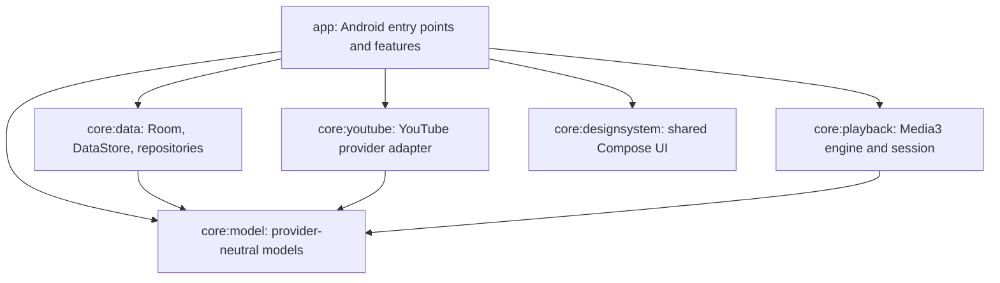

# SungMobile architecture

This guide describes the current Android source layout and the direction dependencies should take. Keep changes small and preserve existing persistence, playback, and UI behavior when moving code.

## Module boundaries

The arrows mean “depends on.” Keep dependencies pointed toward the small, reusable core modules. Core modules must not depend on `app` or feature UI.

| Module | Owns | Keep out |
| --- | --- | --- |
| `core:model` | Provider-neutral catalog, queue, library, playback, and recommendation models/contracts. | Android UI, Room, provider-specific response types. |
| `core:youtube` | NewPipeExtractor integration, catalog requests/parsing, source error mapping, and YouTube lyrics access. | Compose, persistence, playback engine ownership. |
| `core:data` | Room database/DAOs/migrations, DataStore, backup formats, repositories, local audio and lyric file access. | Screens and navigation. |
| `core:playback` | Media3 player/session integration, queue coordination, playback state and commands. | App screens and feature navigation. |
| `core:designsystem` | Theme, icons, artwork and reusable Compose controls. | Feature state, repositories, app-specific navigation. |
| `app` | Android entry points, dependency assembly, feature screens/ViewModels, navigation and platform permissions. | Duplicated storage/provider rules that belong in a core module. |

Spotify library import follows the same boundary: the account session store, validation, web requests and response parsing live in `core:data`; provider-neutral playlist and track models live in `core:model`; the import preview and matching UI live in `app/src/main/java/com/karthi/sungmobile/feature/spotify/`. The importer resolves Spotify track metadata against the YouTube Music catalog, then writes matched songs through `LibraryRepository`. It does not download Spotify audio or retain unmatched Spotify-only tracks in the local library.

Do not add a module just to shorten a file. Add one when it creates a real ownership boundary or allows an independently reusable/testable component.

## Runtime ownership

- `SungApplication` initializes application-wide services and recovery tasks.
- `AppContainer` lazily constructs app-scoped repositories and provider adapters. It is the composition root, not a place for feature behavior.
- `MainActivity` creates screen ViewModels and connects them to the app container.
- `SungRoot` collects feature state and wires dependencies into the UI. Keep it focused on state collection and composition.
- `SungApp` owns top-level destinations, overlays, and UI back behavior. Screens own their local presentation; ViewModels own feature actions/state.
- `SungPlaybackService` owns the active Media3 player and session. `PlaybackConnection` is the UI's remote control. Closing the UI controller must not release service-owned playback.

A feature should call a narrow repository or playback contract. It should not instantiate a second player, access another feature's ViewModel, or reach directly into another screen's state.

## Data and provider flow

- Map provider responses into `core:model` before they cross into feature UI.
- Keep network parsing and provider limitations in `core:youtube`; report unavailable or partial results explicitly.
- Keep persistence operations and transaction rules in `core:data`. Screens should not open Room directly.
- Room owns durable queue/library/history records and schema migrations. DataStore owns preferences. Preserve exported schemas and migration paths; do not use destructive fallbacks for user data.
- Android Auto Backup and device transfer are excluded. The explicit JSON backup/restore flow validates imported data and applies its documented merge rules.
- Streaming URLs and other short-lived playback details stay transient. Do not persist or expose them in diagnostics.
- Spotify's web session cookie and short-lived personal access token are encrypted with an Android Keystore key and kept under `noBackupFilesDir`; they are not included in app backup. Disconnecting clears both. This integration uses private Spotify web-player interfaces, so account validation and import can stop working if those interfaces change.

## Feature organization

Place Android UI and feature controls in `app/src/main/java/com/karthi/sungmobile/feature/<feature>/`. Keep related screen, state, and ViewModel code close to that feature, but split files when responsibilities differ. Put reusable models, validation, repositories, and database logic in descriptive files under `core/data` or `core/model`.

Prefer explicit state and action types over long sets of unrelated Boolean flags or callback lists. Extract a route/host when it gives a feature a clear boundary; avoid broad navigation rewrites that risk saved-state and back behavior.

## Tests and changes

Place tests beside the module they exercise under `src/test`. Add migration and restoration tests when a change can affect stored user data. Keep UI tests focused on observable behavior. Device-only behavior (MediaStore, SAF, background services, installation, and OEM restrictions) still needs device checks; host tests do not prove those flows.

For more detail on repository conventions, see [`CONTRIBUTE.md`](../CONTRIBUTE.md) and [`AGENTS.md`](../AGENTS.md).
