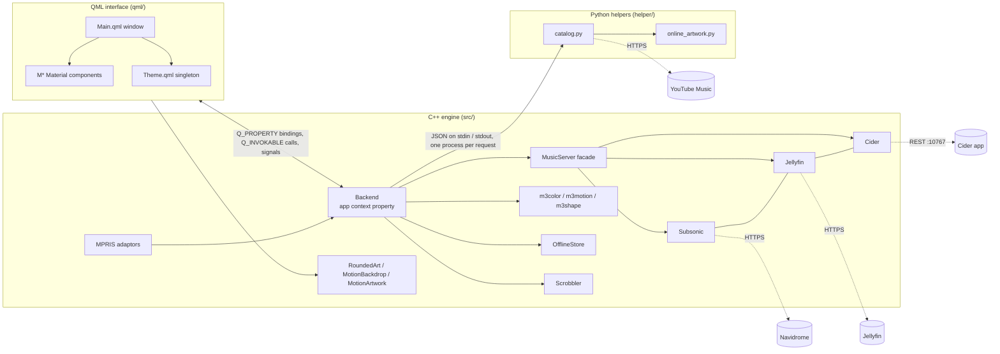
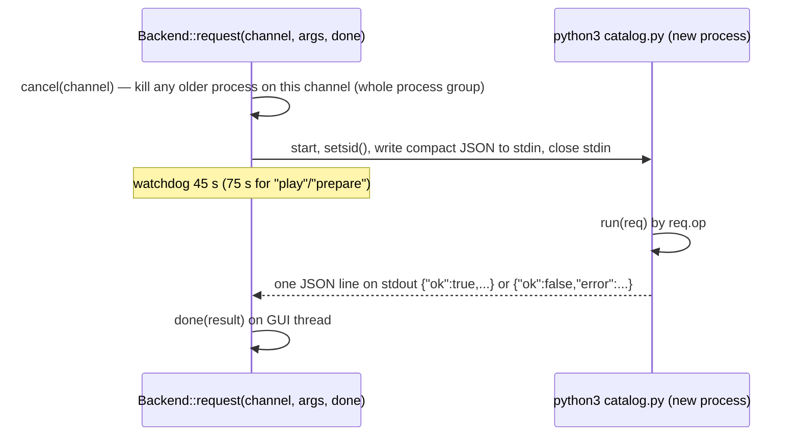
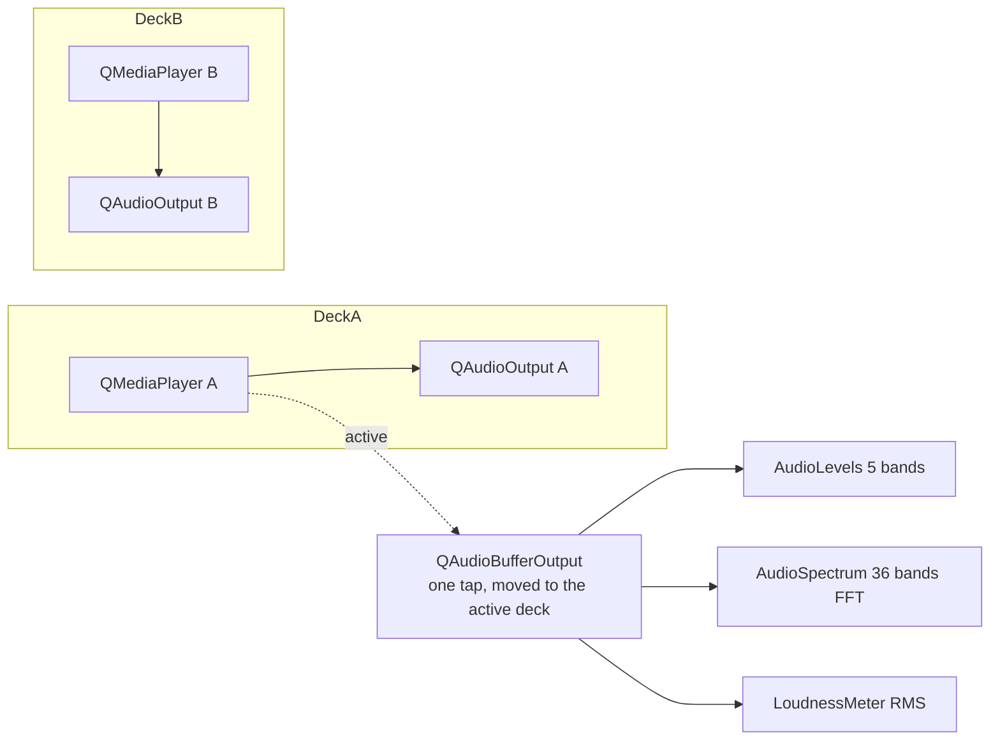
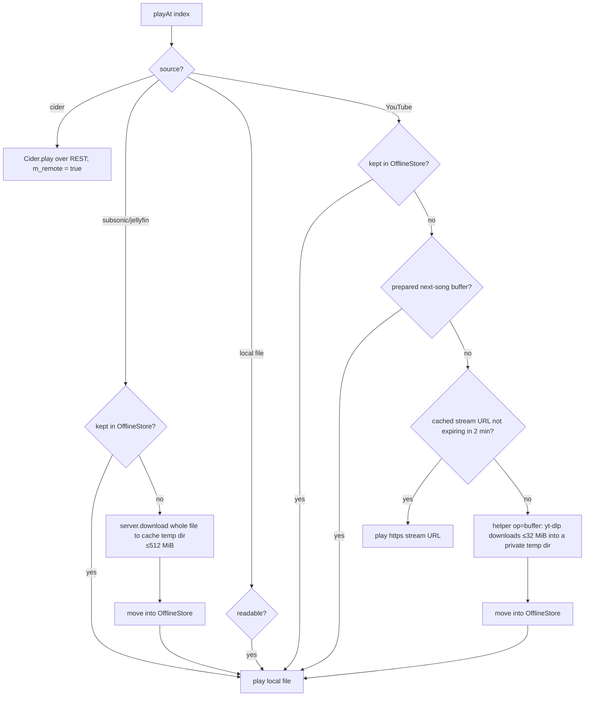
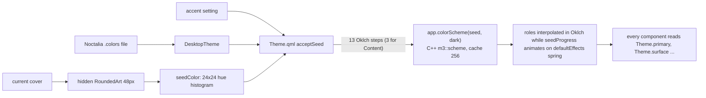

# Architecture

## The big picture (plain words)

Sung has three layers that talk to each other:

1. **The window (QML).** Everything you see. Written in QML, Qt's declarative UI language. It never fetches anything itself; it reads properties from the backend and calls its methods.
2. **The engine (C++).** One big `Backend` object plus helpers: playback, queue, library, lyrics, settings, music-server clients, colour/shape/motion maths, image loading.
3. **The helpers (Python).** Small scripts started as a *new process for every request*. They do the jobs Python libraries are good at: talking to YouTube Music, downloading audio with `yt-dlp`, reading file tags with `ffprobe`, scanning folders, finding animated artwork.



## Folder layout

| Folder | Role |
| --- | --- |
| `src/` | C++ backend, colour/shape/motion engines, image items, MPRIS, `main.cpp` |
| `qml/` | Interface. `Theme.qml` holds every design token. Components prefixed `M` implement a Material component (`MButton`, `MDialog`…) |
| `helper/` | `catalog.py` (all YouTube / file / folder work), `online_artwork.py` (Apple/MusicBrainz cover lookup), `requirements.txt` |
| `assets/` | 138 Material Symbols SVGs (3 optical sizes), app icon, `.desktop` file |
| `tests/` | Unit tests, protocol tests, the in-app UI test harness, fixtures, `verify.py`, `profile.py` |
| `scripts/` | `setup.sh`, `build.sh`, `run.sh`, `test.sh`, `verify.sh`, `install.sh`, `uninstall.sh` |

## Startup sequence (`src/main.cpp`)

1. Set environment defaults before Qt starts:
   - `QT_FFMPEG_DECODING_HW_DEVICE_TYPES=,` and the encoding equivalent → **hardware video decoding off** (more predictable, fewer driver problems).
   - `QSG_ATLAS_WIDTH/HEIGHT=1024` → smaller Qt Quick texture atlas (saves ~16 MiB heap + 15 MiB pinned on NVIDIA at 1.6× scale).
2. Create `QGuiApplication` (name `sung`, org `Sung`, version 0.12.0). `--version` prints and exits.
3. **Single instance:** connect to local socket `sung-<uid>`. If another Sung answers within 120 ms, send it the last argument (a link, `--mini`, or `"raise"`) and exit. Otherwise start a `QLocalServer` with user-only access. `--isolated` skips all of this (used by tests).
4. Qt Quick Controls style `Basic` (everything is restyled by hand). App font: `Google Sans Flex` if installed, else `Noto Sans`, 14 px.
5. Register C++ types for QML under `Sung.Native 1.0`: `RowSelection`, `RoundedArt`, `MotionBackdrop`, and uncreatable `MotionArtwork`.
6. **Start compiling `Main.qml` asynchronously** (`QQmlComponent::Asynchronous`) *before* building the backend, so QML type loading overlaps with the backend reading the library and opening audio devices. Measured gain: 231.8 → 213.7 ms (empty library), 392.7 → 370.0 ms (10,000 songs, offscreen).
7. Build `Backend` (in a `std::optional` so it outlives the engine). Wire `RoundedArt`'s static resolvers to the backend (server artwork requests, video-frame → album cover).
8. Register MPRIS on D-Bus (unless `--isolated`).
9. Expose context properties: `app` (Backend), `motionArtwork`, `desktopTheme`, `windowResources`; add the `symbols` image provider.
10. `engine.load("qrc:/qml/Main.qml")`.
11. After the **first frame**, call `malloc_trim(0)` to hand freed startup memory back to the OS (16–24 MiB with 10k songs). Also trim whenever the app stops being active.
12. Handle local-socket messages from later launches: `https://` links open in Sung; `--mini` opens the mini player; anything else raises the window.
13. Without a link and without `--offline`, open the start page (Home, Local files, Server or Liked).

Diagnostic builds (`-DSUNG_DIAGNOSTICS=ON`) add ~60 `--xxx-test` flags plus probes (`SUNG_STARTUP_PROBE`, `SUNG_OBJECT_PROBE`, `SUNG_IDLE_PROBE`, `--benchmark`) compiled into the same binary.

## The Backend object

`Backend` (`src/backend.h`, ~940 lines of declarations) is a single `QObject` exposed to QML as `app`. It has **about 130 `Q_PROPERTY`s** and **about 140 `Q_INVOKABLE` methods**. Its implementation is split across:

| File | Contents |
| --- | --- |
| `backend.cpp` (~2,900 lines) | Constructor/wiring, helper process requests, navigation, playback, queue, lyrics, volume/normalisation, sleep timer, library load/save, likes, playlists, undo, M3U, local import, folder scan, smart playlists, track details, crossfade/gapless, Cider glue, meters |
| `productfeatures.cpp` | Album/artist info, artwork choice and video-cover memory, folder watching, local album/artist grouping, playlist covers, artwork fit, listening sessions, output-disconnect detection, listening stats + calendar, playlist versions, scrobble timing |
| `presentationfeatures.cpp` | Density, sidebar, start page, Home section order/hide, per-view layout (grid/list, density), lyric gap countdown |
| `backendserver.cpp` | Music-server glue: playback reporting, server listen counting, server browse requests, server playlist edits, ratings, server queue save/restore |

It owns: three list models, the collection proxy, both playback decks, the music-server facade, offline store, scrobbler, notifier, `QSettings`, timers, and the map of running helper processes.

### Signals as the UI's "invalidation" channels

The backend groups changes into a small set of NOTIFY signals so QML re-evaluates only what is needed:

`catalogChanged` (page/results/title), `trackChanged`, `playbackChanged`, `positionChanged` (throttled to 4 Hz), `lyricsChanged`, `lyricIndexChanged` (only when the line actually changes), `libraryChanged`, `settingsChanged`, `presentationChanged`, `queueInfoChanged`, `audioLevelsChanged` (≤30 Hz), `audioSpectrumChanged`, `onlineArtworkChanged`, `errorChanged`, `toast(message)`, `seeked(position)`, `raiseRequested`.

### Models given to QML

- **`Entries`** (`QAbstractListModel`) — a list of `QVariantMap` rows. Roles: `entry`, `musicSource` ("YouTube Music" / "Local files" / "Music server" / "Apple Music"), `musicFolder`, `musicDisc`, `queueOrigin` ("Added by you" / "Autoplay" / "Collection"). Its `reconcile()` computes moves/inserts/removes for lists up to 512 rows so delegates (and their animations) survive small queue edits; bigger lists reset.
  Instances: `results` (current page), `queue`, `listPane` (list-detail left pane), `recentlyPlayed` (60 rows).
- **`CollectionView`** (`QSortFilterProxyModel` over `results`) — filter by space-separated terms across title/artist/album/path; sort by original/title/artist/duration/folder using `QCollator` with numeric mode. Never changes saved playlist order.
- **`RowSelection`** — selection set owned by the model, not by recycled delegates. Ctrl/Shift click semantics, select-all, excluded rows (collapsed groups). Clears itself on any model reset/move.

## Navigation model

The backend, not QML, owns "where am I":

- `m_page` (`home`, `search`, `album`, `artist`, `playlist`, `link`, `library`, `local`, `local-album`, `local-artist`, `server`), `m_title`, `m_cover`, `m_sections` (Home/artist shelves), `m_results`, `m_request` (the request that produced the page), `m_libraryId`.
- **Back stack**: `navigate(push=true)` stores a `snapshot()` of the page (max 12). `back()` restores it, then refreshes local data that may have changed.
- **Per-view options**: each view key (e.g. `search:<query>:<filter>`, `album:<id>`, `library:favorites`) remembers its filter text and sort; LRU of 32. QML separately remembers scroll positions per view key (also 32).
- **List-detail pane**: opening an album/artist from the local Albums/Artists grid keeps the grid alive in `listPane` beside the detail (Material's list-detail layout).
- `browseRequest()` decides between pushing a new view and extending the current one (paging appends only if the new rows start with the existing ones).

## Helper process protocol



- **One channel = one in-flight request.** Starting a new `catalog` request kills the previous one. Channels used: `catalog`, `play`, `prepare`, `radio`, `lyrics`, `linkplay`, `coverplay`, `local-import`, `folder-scan`, `cleanup`, `motion-artwork`, `choose-artwork`.
- The child runs in its own session (`setsid`) so `kill(-pid, SIGKILL)` takes down `yt-dlp`'s children too.
- Python path: `SUNG_PYTHON`, else bundled venv `../runtime/bin/python` or `../lib/sung/runtime/bin/python`, else `python3`. Helper path: `SUNG_HELPER`, else next to the binary, else `../lib/sung/catalog.py`.
- Input capped at 16 MiB; errors truncated to the last 1,800 characters; backend rewrites common errors into friendly text (network, sign-in, unavailable).

Helper operations (`req.op`): `home`, `search`, `album`, `playlist`, `artist`, `radio`, `lyrics`, `local-lyrics`, `link`, `resolve`, `buffer`, `local-files`, `scan-folders`, `playlist-cleanup`, `choose-artwork`, `online-artwork`.

## Music server facade

`MusicServer` holds three clients but uses one at a time (`server/provider` setting):

```
class Subsonic : QObject          ← base: token auth, call(), browse(), download()...
class Jellyfin : public Subsonic  ← hides (not overrides) every member
class Cider    : public Subsonic  ← hides every member, adds playback control
```

Because the subclasses *hide* rather than override (no `virtual`), `MusicServer::with(lambda)` uses a generic lambda to dispatch to the concrete type at compile time:

```cpp
template <class Call> decltype(auto) with(Call call) {
  if (m_provider == "jellyfin") return call(m_jelly);
  if (m_provider == "cider")    return call(m_cider);
  return call(m_sub);
}
```

All three share: `connectServer`, `browse(request)`, `download(track, path)`, `cover`, `lyrics`, `star`, `rate`, `editPlaylist`, `removePlaylist`, `scrobble`, `owns(track)`, `item(raw, kind)` (normalise a server row into Sung's track map), `artworkUrl`.

Every network call has a **channel** too (`login`, `catalog`, `audio`, `cover`, `lyrics`, `poll`…), and a **generation counter**: disconnecting bumps it so late replies are ignored.

## Playback engine

### Two decks



- `m_media()` returns the active deck, `spareDeck()` the other. Both decks' signals are connected but handlers ignore the spare (`isActive(deck)`).
- The decoded-audio tap is attached **only to the active deck**: attaching to both starved the active one of buffers.
- Volume actually sent to the mixer = `userVolume × sleepGain × normalizationGain`, clamped to 1.

### Resolving a track (`resolveCurrent`)



- Buffers live under the **cache directory**, not `/tmp` (which is RAM-backed tmpfs on CachyOS).
- Every track change bumps `m_trackToken`; every async callback checks the token and drops stale results.
- Stream errors trigger `recoverStream()` up to 2 times: forget the cached URL and the kept file, retry with the other container (`m4a` vs `webm`), restore position.

### Crossfade and gapless

- `considerCrossfade()` runs on each position update. With crossfade *N* s and a track at least 2·N long, when ≤ N s remain it picks the target (`handoffTarget()`: next, wrap with repeat-all, or a pre-chosen random index for shuffle) and checks `overlapSuits()`:
  - **No overlap** into an autoplay song or between two tracks of the same album (`sameAlbum`: same album id + source + server, or for files the same album-artist|album key with a named album).
- `beginCrossfade()` arms the spare deck with a source that needs **no network** (local file, or the prepared buffer), starts it at volume 0, then every 40 ms sets `active = v·cos(tπ/2)`, `spare = v·sin(tπ/2)` (equal power).
- Without crossfade (or when it doesn't suit), within 2.5 s of the end the spare deck is armed silently; at `EndOfMedia` `finishGapless()` starts it and `adoptHandoff()` swaps decks.
- `adoptHandoff()` moves the tap, stops the old deck, advances the queue index, and runs the bookkeeping that normally happens on "started playing" (history, notifications, normalisation, scrobble).
- Seeking away from the tail cancels any armed handover.

### Next-song preparation

`updatePreparation()` (driven by many signals, debounced with a zero-time timer): if playing, not shuffle, not repeat-one, no sleep-at-end, next item is YouTube and not already kept → start a timer to fire 45 s before the end → helper `buffer` op into its own temp dir. Only files ≤ 32 MiB inside that dir are accepted; `posix_fadvise(DONTNEED)` drops it from page cache until needed.

### Remote playback (Cider)

When the current track's source is `cider`, `m_remote = true`: Sung's decks are idle; `Cider::play()` sends `play-item`, then polls `now-playing` + `is-playing` every 1 s while playing (2 s while paused and the window is visible, not at all when hidden), interpolating position with a local clock between polls. End of song is detected near the end (≤ 4 s / ≤ 1.5 s rules). Speed, crossfade and normalisation do not apply. For meters, `OutputTap` runs `parec` on the default output's monitor.

## Persistence

| What | Where | How |
| --- | --- | --- |
| Library (tracks, likes, history, plays, playlists, versions, sessions, pins, lyric offsets, queue, index, position) | `~/.local/share/Sung/sung/library.json` | Compact JSON via `QSaveFile` (atomic), mode 0600. Written on a **single-thread `QThreadPool`** 600 ms after the last change; `save()` (exit, tests) waits for it. A parse failure marks storage unhealthy and **stops all saves** so the original file is preserved. |
| Settings and bounded caches | `~/.config/Sung/sung.conf` (QSettings) | Appearance, playback, per-song loudness/trim/resume (2000/2000/400), artwork choices (1000), fit choices (2000), video covers (2000), view layouts (64), server addresses, scrobble queue (500) |
| Secrets | Desktop keyring via `secret-tool` | Subsonic password, Jellyfin token, Cider token, ListenBrainz token |
| Audio buffers | `~/.cache/Sung/sung/audio-XXXXXX/` | `QTemporaryDir`, deleted when done |
| Kept songs | `~/.cache/Sung/sung/songs/` | File name = first 32 hex of SHA-256(key); the directory *is* the index |
| Artwork HTTP cache | `~/.cache/Sung/sung/art/` | `QNetworkDiskCache`, 48 MiB |
| Animated covers | `~/.cache/Sung/sung/motion-art/` | MP4s + JSON lookup records, pruned to 256 MiB / 256 records |
| Local cover posters | `~/.local/share/Sung/sung/local-art/` | 512 px JPEGs, 48 MiB cap |
| Imported lyrics | `~/.local/share/Sung/sung/lyrics/<id>.lrc` | ≤ 256 KiB each, 8 MiB total |
| Playlist covers | `~/.local/share/Sung/sung/playlist-art/` | 512 px JPEG named by SHA-256 of playlist id |

On load, `librarydata::Reader` de-duplicates repeated strings and identical song objects so Qt's implicit sharing keeps one copy in memory.

## Theme / colour data flow



Priority: artwork accent (if on and the cover is colourful) → chosen accent → desktop palette (theme "system" + Noctalia file present) → built-in default (`#b75f38`, with a hand-tuned palette kept pixel-identical at standard contrast).

## Image pipeline

- **`RoundedArt`** (C++ `QQuickPaintedItem`) is the one cover renderer. It masks to a rounded rect or any Material shape (and morph between two), crossfades on a spring, can blur once on the CPU, and computes the minimum scrim needed for text over it.
- Loads go through: decoded-image `QCache` (8 MiB, key = URL|pixels) → shared in-flight local decodes → dedicated decode thread pool (2–4 threads) → or network via a shared `QNetworkAccessManager` with disk cache.
- Before fetching, URLs are rewritten to ask for the drawn size (`artworkurl::sized`), and YouTube video frames are swapped for the remembered album cover (`albumCoverFor`). If a resized request fails, it retries once with the original URL.
- **`MotionArtwork`** — one decoder for the current animated cover shared by all surfaces (`QMovie` for GIF/WebP, `QMediaPlayer` + `QVideoSink` with no audio for MP4/WebM). Frames capped at 800 px (or the Motion layout's tier).
- **`MotionBackdrop`** (C++ scene-graph item) — the Motion layout's full-window cover with a feathered blurred edge built from a ~128-px copy, plus per-band scrim solving.

## Desktop integration

- **MPRIS** (`mpris.cpp/.h`): `org.mpris.MediaPlayer2.sung` with Root and Player adaptors; emits `PropertiesChanged` and `Seeked`.
- **Notifications** (`playbacknotifier.cpp`): async `org.freedesktop.Notifications.Notify`, replaces its own previous notification, transient and silent.
- **Noctalia** (`desktoptheme.cpp`): watches `~/.local/share/color-schemes/noctalia.colors` (and its folder, for atomic replaces), maps 11 KDE colour anchors, derives the rest with `m3::scheme`.
- **WindowResources**: 30 s after a window is hidden or minimised, release the scene graph and graphics resources; restore persistence on show.
- **Single instance & links**: local socket; `.desktop` declares `x-scheme-handler/sung`.
