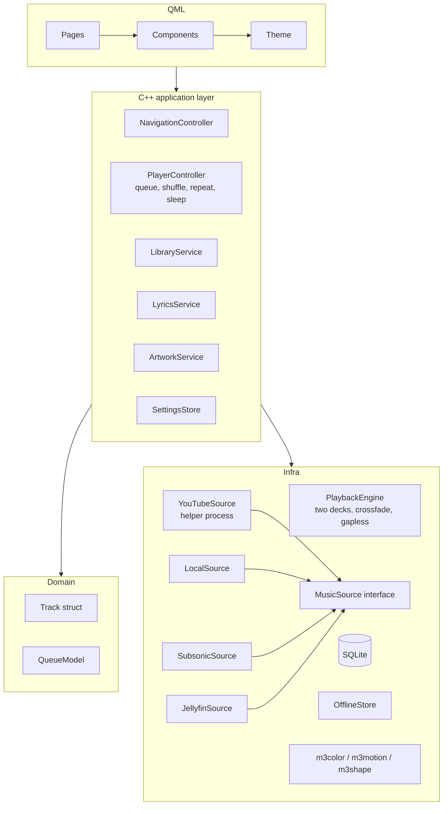

# Rebuild guide: starting a related project from Sung

How to turn these notes into a new project. First the licence, then what to reuse, then a suggested architecture and build order, then notes for other tech stacks.

## 1. Licence check (read first)

- Sung's code is **MIT**: you may copy, change and redistribute it, including commercially, as long as you **keep the copyright and licence notice**.
- **Material Symbols** icons: Apache-2.0 (keep `licenses/MaterialSymbols-LICENSE.txt` and the NOTICE text).
- **`src/m3shape.cpp`** ports androidx graphics-shapes / Compose MaterialShapes: Apache-2.0 → keep the attribution in NOTICE.
- **yt-dlp** (Unlicense), **ytmusicapi** (MIT), **Qt** (LGPL, link dynamically).
- Downloading from YouTube and scraping Apple's pages carry terms-of-service risk regardless of licence (see PROBLEMS.md §2).

## 2. Ideas for related projects

| Idea | What to take from Sung |
| --- | --- |
| A lighter "files + server only" player (no YouTube) | Playback engine, offline-free local import, Subsonic/Jellyfin clients, theme engine. Drop Python/yt-dlp/Node entirely. |
| A podcast / audiobook player | Two-deck engine, resume-long-recordings logic, speed + pitch, sleep timer with fade, offline store, MPRIS. |
| A lyrics / visualizer companion app (reads MPRIS of any player) | LRC parser + timing, sing-along, poster lyrics, spectrum ring, `parec` output tap, shape morph, ambient backdrop. |
| A Material 3 Expressive component kit for Qt/QML | `Theme.qml`, `m3color`, `m3motion`, `m3shape`, the `M*` components, `RoundedArt`, `MElevation`, `MSmoothWheel`. |
| A listening-stats / scrobbling tool | Play log + daily totals, calendar quartile logic, ListenBrainz client with offline queue. |
| A cross-platform version (Windows/macOS/Android) | Concepts and algorithms; replace Linux-only pieces (D-Bus, `pactl`, `secret-tool`, `setsid`, `malloc_trim`). |
| A YouTube Music desktop client only | `catalog.py`, helper-process pattern, buffering, artwork matching. |

## 3. What to copy almost as-is (high value, low coupling)

| Component | Files | Depends on |
| --- | --- | --- |
| Material colour engine | `src/m3color.h/.cpp` | QtGui (`QColor`) only |
| Spring → curve engine | `src/m3motion.h/.cpp` | QtCore |
| Material shapes + morph | `src/m3shape.h/.cpp` | QtGui (`QPainterPath`) |
| CPU blur | `src/softimage.h` | QtGui |
| Scrim solver | `src/scrimcontrast.h` | QtGui |
| Audio meters / FFT / loudness | `src/audiolevels.h` | QtMultimedia (`QAudioBuffer`) |
| LRC parser | `src/lrc.h` | QtCore |
| Offline store | `src/offlinestore.h/.cpp` | QtCore |
| JSON de-dup reader | `src/librarydata.h` | QtCore |
| Artwork URL helpers | `src/artworkurl.h` | QtCore |
| Row selection, collection proxy | `src/rowselection.h`, `src/collectionview.h` | QtCore |
| ListenBrainz client | `src/scrobbler.h/.cpp` | QtNetwork |
| Subsonic / Jellyfin clients | `src/subsonic.*`, `src/jellyfin.*` | QtNetwork (+ `secret-tool`) |
| MPRIS, notifications | `src/mpris.*`, `src/playbacknotifier.*` | QtDBus (needs a backend interface) |
| Design tokens | `qml/Theme.qml` | `app.colorScheme`, `app.motionSprings`, a few `app.*` settings |
| QML components | `qml/M*.qml`, `Icon.qml`, `SungText.qml` | `Theme`, `app.shapeOutline` (shapes), icon provider |
| Python helper | `helper/catalog.py`, `online_artwork.py` | ytmusicapi, yt-dlp, ffmpeg |

Unit tests for the engines exist (`tests/m3*_test.cpp`) — copy them too.

## 4. What to redesign rather than copy

- **`Backend`** — split into services (see §5).
- **`Main.qml`** — split into region files.
- **Storage** — replace `library.json` + QSettings caches with SQLite (tables: tracks, playlists, playlist_items, likes, plays, daily_totals, settings, caches).
- **MusicServer inheritance** — use an interface.
- **Track maps** — typed struct with a `toVariantMap()` for QML.
- **Version/constants** — single source (CMake `configure_file`).

## 5. Suggested architecture for the new project



Key contracts:

```cpp
struct Track {           // typed, converts to QVariantMap for QML
  QString id, source, server, remoteId, videoId, localPath;
  QString title, artist, album, albumArtist, albumId, artistId, art;
  int seconds = 0, disc = 1, trackNo = 0, year = 0;
  bool available = true;
  bool isPlayable() const;
};

class MusicSource : public QObject {      // one per provider
public:
  virtual QString id() const = 0;
  virtual void browse(const BrowseRequest&, Reply) = 0;
  virtual void search(const QString&, Filter, Reply) = 0;
  virtual void fetchAudio(const Track&, const QString& path, Reply) = 0; // whole file
  virtual void lyrics(const Track&, Reply) = 0;
  virtual void cover(const Track&, int px, Reply) = 0;
  virtual bool owns(const Track&) const = 0;
  virtual void cancel(const QString& channel) = 0;
};
```

Keep Sung's best patterns:
- **Generation/token checks** on every async reply.
- **Channels** for cancellable requests.
- **Whole-file buffering + offline store** (or stream + cache, if latency matters more).
- **Two decks** for crossfade/gapless.
- **Signals grouped by concern**, throttled position updates.
- **Bounded caches** with documented limits.
- **Design tokens in one place** and motion only through spring tokens.

## 6. Suggested build order (milestones)

1. **Skeleton**: CMake + Qt 6.8, QML module, `Theme.qml` with fixed default palette, `SungText`, `Icon` + symbols provider, `MButton`, window with top bar and empty pages.
2. **Local playback**: import files via a tag reader (ffprobe helper or TagLib), `Track` model, one `QMediaPlayer`, queue, player bar with seek bar, MPRIS.
3. **Library & storage**: SQLite schema, likes, playlists, history, undo, track list with selection and drag.
4. **Colour/motion/shape engines**: drop in `m3color/m3motion/m3shape`; animated theme from cover; springs everywhere; loading indicator.
5. **Artwork pipeline**: `RoundedArt`-style item with cache, decode pool, crossfade; ambient backdrop.
6. **Second deck**: crossfade + gapless + next-track preparation; normalisation; sleep timer.
7. **Remote sources**: Subsonic, Jellyfin (and/or YouTube helper), offline store.
8. **Lyrics**: LRC parse, sources chain, lyrics panel, sing-along.
9. **Immersive/visualizer**: FFT tap, spectrum ring, shape morph, Motion layout if you want animated covers.
10. **Polish**: settings dialog, onboarding, command palette, accessibility pass, stats, sessions.
11. **Testing & measuring**: unit tests per engine/service, an offscreen smoke test in CI, a `profile.py` equivalent, then a UI stage harness if the project grows.

Each milestone should end with: tests, a screenshot check in light/dark/narrow/wide, and an idle CPU/RSS measurement.

## 7. If you use a different tech stack

| Stack | Notes |
| --- | --- |
| **Qt 6 / QML + C++** (same as Sung) | Easiest reuse — copy files directly. Keep the software renderer constraint only if you need it. |
| **Qt for Python (PySide6)** | QML files reusable; port backend to Python; keep m3 engines in C++ or port (they are pure maths). |
| **Kotlin + Jetpack Compose (Android/Desktop)** | Material 3 Expressive, dynamic colour (`MaterialKolor`/MCU), springs and `MaterialShapes` come built in — you'd mostly port the playback, sources and helper logic (Media3/ExoPlayer has gapless; crossfade needs two players). |
| **Flutter** | `material_color_utilities` package gives HCT/schemes; springs via `SpringSimulation`; shapes need a port of `m3shape`; `just_audio` for playback. |
| **Electron / Tauri + web (React/Svelte)** | `@material/material-color-utilities` (TS) for colour; springs via a physics lib or port `m3motion`; Web Audio API `AnalyserNode` replaces the FFT; Python helper can stay as a sidecar. Much heavier RAM than Sung. |
| **Java (desktop, JavaFX)** | Port the maths (straightforward), use VLCJ or JavaFX Media for playback; Material look must be hand-built. |

Algorithms in METHODS_AND_TECHNIQUES.md are language-neutral; port them with their unit tests.

## 8. Checklist before you start coding

- [ ] Decide sources (YouTube? files? servers? Apple via Cider?) — this decides the whole dependency chain.
- [ ] Decide storage (SQLite recommended).
- [ ] Decide buffering vs streaming.
- [ ] Copy licences/NOTICE for anything taken from Sung.
- [ ] Set up tokens (`Theme`) and springs before building components.
- [ ] Write the `Track` type and `MusicSource` interface first.
- [ ] Add a measurement script on day one (idle CPU, RSS, startup time).
- [ ] Add CI with at least build + unit tests + one offscreen launch.
- [ ] Plan i18n (`qsTr`) from the start.
